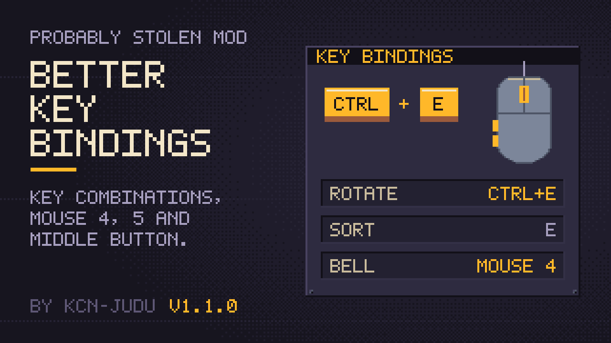

# Better Key Bindings



A mod for *Probably Stolen*. Every key binding in the options takes key combinations such as Ctrl + E, the middle mouse button, mouse buttons 4 and 5, and the mouse wheel. A combination never also triggers a binding on its key alone. The key the game uses for precise placement becomes a binding too, and choosing a key that is already in use asks whether to unbind the other binding.

Mods that read keys straight from the engine, instead of offering a key binding in the game's options, are outside what this mod handles; see the [disclaimer](doc/manual/index.md#disclaimer-keys-that-other-mods-read-directly). Mod authors: please make your keys bindings.

**Documentation:** <https://kcn-judu.github.io/ProbablyStolen-Mods/en/better-key-bindings/> ([简体中文](https://kcn-judu.github.io/ProbablyStolen-Mods/zh-cn/better-key-bindings/))

Part of the [Probably Stolen mods collection](https://github.com/KCN-judu/ProbablyStolen-Mods).

## Install

Subscribe on the [Steam Workshop](https://steamcommunity.com/sharedfiles/filedetails/?id=3832574517), or copy the folder from a [release](https://github.com/KCN-judu/ProbablyStolen-BetterKeyBindings/releases) into the game's `Mods` folder. Then enable the mod in the game's Mods menu and restart the game.

## Build

```bash
./build.sh            # out/better_key_bindings
./build.sh --install  # also copies it to the game's Mods folder
```

See [Building](doc/manual/building.md) for the requirements and the `GAME` and `CSC` variables.

## Repository layout

| Path | Contents |
| --- | --- |
| `src/` | The mod's source |
| `Localization/` | The mod's text, one file per game language |
| `tests/` | Headless checks of the mod's decisions and the mod scanner check (`tests/run.sh`) |
| `doc/manual/` | Documentation, in English (the source of every translation) |
| `doc/locale/` | Translations of the documentation, as gettext catalogs |
| `manifest.xml`, `preview.png` | What the game reads, next to the DLL |
| `WORKSHOP.txt` | The Steam Workshop description, in BBCode |
| `CHANGELOG.md` | Changes by version |

## License

[Apache License 2.0](LICENSE).
