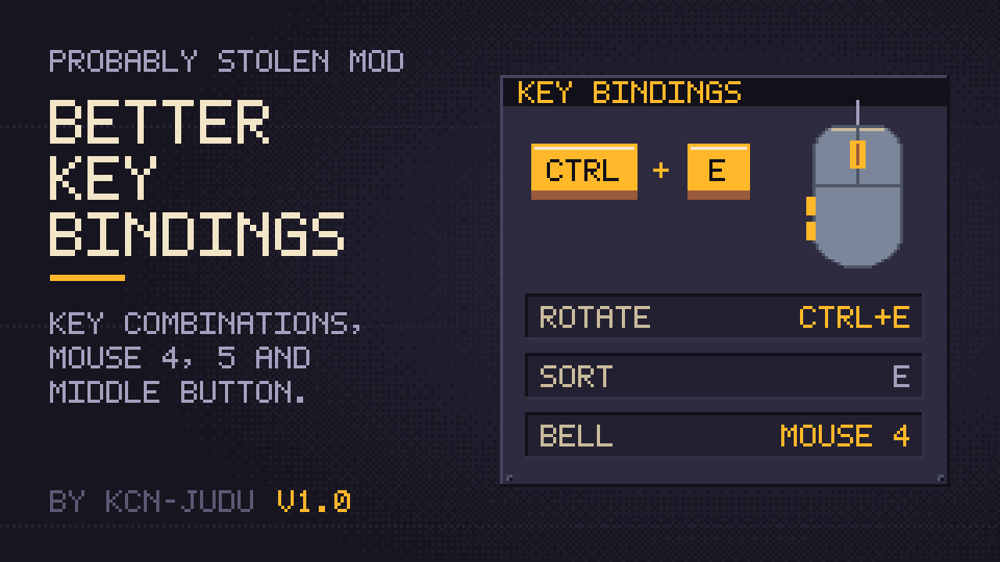

# Better Key Bindings

Every key binding in the game's options takes key combinations such as Ctrl + E, and the middle mouse button and mouse buttons 4 and 5. A combination never also triggers a binding on its key alone. The keys the game uses while dragging items can be rebound too.

## Binding a combination

1. Open the options and click a key binding.
2. Hold Ctrl, Shift or Alt, in any mix, and press the key or mouse button. The button shows the combination while you hold it.
3. Let go of every key. Only then is the combination taken, so holding Shift on its way to Shift + Space never counts as Shift alone.
4. To bind a modifier on its own, such as Left Shift, press it and let go without pressing another key. Holding Ctrl and Left Shift and letting go binds Ctrl + Left Shift.
5. Press Escape to keep the old binding.
6. Click **Apply**. Until then nothing is changed.

The middle mouse button and mouse buttons 4 and 5 can be bound like any key, with or without modifiers. The left and right buttons stay with the game.

## Combinations and single keys

When several bindings share a key, the one that asks for the most of the held modifiers wins:

- With E bound to one action and Ctrl + E to another, Ctrl + E runs only the second, and E alone runs only the first.
- Shift + E still runs the E binding when nothing is bound to Shift + E, as the game does without the mod.
- Ctrl + Shift + E runs a Ctrl + Shift + E binding, and neither the Ctrl + E nor the E binding.

## Keys already in use

Choosing a combination that another binding already uses opens a prompt: **Unbind and use** clears the other binding and gives the combination to this one, and **Cancel** keeps both as they were. The cleared binding shows *None* until you bind it again. Both changes wait for **Apply**.

Bindings that other mods add to the options take combinations too. One exception: two bindings of the same other mod cannot share a key with different modifiers, because that mod reads only the key and could not tell them apart, so that counts as a conflict.

## Keys held while dragging

The mod's own section of the options holds a key the game otherwise fixes:

| Binding | Game default | What it does |
| --- | --- | --- |
| Precise placement (hold while moving a selection) | Shift | Held while moving several selected items: place them exactly. |

It takes combinations and mouse buttons as well. For a modifier key, either side counts.

### Deprecated key bindings

Two more keys the game checks sit in a section of their own, marked deprecated:

| Binding | Game default | What it does |
| --- | --- | --- |
| Pick up only one (hold + drag) | Left Alt | Held when you start dragging several of an item: pick up just one. |
| Pick up half (hold + drag) | Left Shift | Held when you start dragging several of an item: pick up half of them. |

They still work, but nothing in the current game reaches them: they only matter for an item worth several units, and no item the game creates in play has more than one. Their tooltips say so.

## Limits

- Two bindings of the same other mod cannot share a key, even with different modifiers.
- Turning the mod off keeps each binding's key and drops its modifiers, so Ctrl + E becomes E.
- Built for game version 0.46D.
