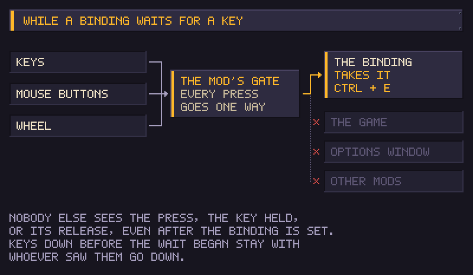
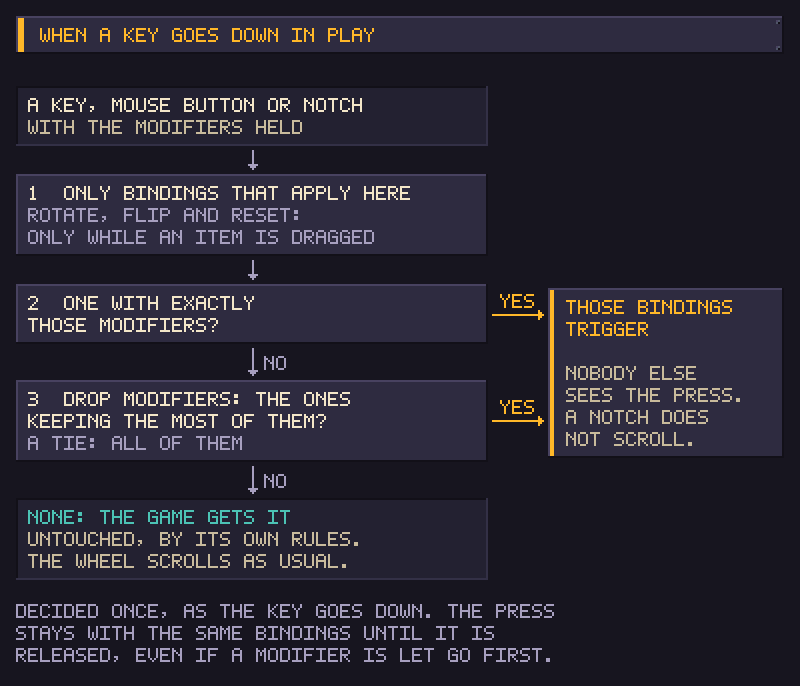

# Better Key Bindings

Every key binding in the game's options takes key combinations such as Ctrl + E, the middle mouse button, mouse buttons 4 and 5, and the mouse wheel. A combination never also triggers a binding on its key alone. The keys the game uses while dragging items can be rebound too.

## Binding a combination

1. Open the options and click a key binding.
2. Hold Ctrl, Shift or Alt, in any mix, and press the key or mouse button. The button shows the combination while you hold it.
3. Let go of every key. Only then is the combination taken, so holding Shift on its way to Shift + Space never counts as Shift alone.
4. To bind a modifier on its own, such as Left Shift, press it and let go without pressing another key. Holding Ctrl and Left Shift and letting go binds Ctrl + Left Shift.
5. Press Escape to keep the old binding.
6. Click **Apply**. Until then nothing is changed.

While a binding waits for a key, the keys, mouse buttons and wheel you press go only to the binding: the game, the options window and other mods do not react to them, even when you let go after the binding is taken. Space or Enter does not press the selected button, and the wheel does not scroll the list.

The middle mouse button and mouse buttons 4 and 5 can be bound like any key, with or without modifiers. The left and right buttons stay with the game.

## Binding the mouse wheel

Wheel up and wheel down can be bound like any key, with or without modifiers: click a binding, turn the wheel one notch, and the button shows *Wheel Up* or *Wheel Down*. For Ctrl + wheel up, hold Ctrl, turn the wheel up, then let go of Ctrl.

- Each notch triggers the binding once. Several notches turned quickly trigger it once for each.
- A notch that goes to a binding does not also scroll. Rotating, flipping and resetting an item only apply while you drag one: elsewhere a notch bound to them scrolls as usual. Every other binding applies everywhere, so a plain wheel notch bound to it never scrolls; add a modifier to keep the plain wheel for scrolling.
- Where nothing is bound to the wheel, it scrolls as in the game without the mod. With only Ctrl + wheel up bound, the wheel without Ctrl still scrolls up.
- A notch goes to a binding by the same rule as a key (see below). A notch that no binding takes goes to the game untouched, and the game handles it as it would without the mod.
- The keys held while dragging cannot take the wheel, because a notch cannot be held.

## Combinations and single keys

When a key, mouse button or wheel notch goes down, the mod decides once which binding it belongs to, with the modifiers held at that moment:

1. A binding that asks for exactly the held modifiers.
2. Otherwise, dropping held modifiers, the bindings that ask for the most of them. When several ask for as many, they all run, as one press of each.
3. Otherwise none: the press goes to the game untouched, and the game handles it as it would without the mod.

Rotate, flip and reset orientation only take part while you drag an item; elsewhere they are left out, as if unbound. The press stays with that binding until the key is released, even if you let go of a modifier first. Your bindings come before the game's own handling of a key; only what the game or another mod reads straight from the engine is outside the mod's reach (see the disclaimer below). For example:

- With E bound to one action and Ctrl + E to another, Ctrl + E runs only the second, and E alone runs only the first.
- Shift + E still runs the E binding when nothing is bound to Shift + E, as the game does without the mod.
- Ctrl + Shift + E runs a Ctrl + Shift + E binding, and neither the Ctrl + E nor the E binding.
- With Ctrl + E and Shift + E bound but not Ctrl + Shift + E, Ctrl + Shift + E runs both.
- With nothing bound to the wheel, Ctrl + wheel up while dragging an item does what the game does with it.

## Keys already in use

Choosing a combination that another binding already uses opens a prompt: **Unbind and use** clears the other binding and gives the combination to this one, and **Cancel** keeps both as they were. The cleared binding shows *None* until you bind it again. Both changes wait for **Apply**.

Bindings that other mods add to the options take combinations too. One exception: two bindings of the same other mod cannot share a key with different modifiers, because that mod reads only the key and could not tell them apart, so that counts as a conflict.

## Keys held while dragging

The mod's own section of the options holds a key the game otherwise fixes:

| Binding | Game default | What it does |
| --- | --- | --- |
| Precise placement (hold while moving a selection) | Shift | Held while moving several selected items: place them exactly. |

It takes combinations and mouse buttons as well, but not the mouse wheel. For a modifier key, either side counts.

### Deprecated key bindings

Two more keys the game checks sit in a section of their own, marked deprecated:

| Binding | Game default | What it does |
| --- | --- | --- |
| Pick up only one (hold + drag) | Left Alt | Held when you start dragging several of an item: pick up just one. |
| Pick up half (hold + drag) | Left Shift | Held when you start dragging several of an item: pick up half of them. |

They still work, but nothing in the current game reaches them: they only matter for an item worth several units, and no item the game creates in play has more than one. Their tooltips say so.

## Limits

- Two bindings of the same other mod cannot share a key, even with different modifiers.
- Turning the mod off keeps each binding's key and drops its modifiers, so Ctrl + E becomes E. A binding on the mouse wheel stops working until it is bound again, since the game cannot read the wheel as a key.
- Only rotating, flipping and resetting an item are limited to where they apply (while you drag an item). Every other binding takes its key everywhere, even where its action does nothing, because the game does not show where those actions apply.
- Built for game version 0.46D.

## Disclaimer: keys that other mods read directly

Better Key Bindings works with key bindings: the ones in the game's options, and the ones other mods add there. A mod that reads a key straight from the engine, with no binding the player can see or change, is outside what this mod handles, and we do not work around it. Such a mod may react to a key you meant for a binding, may also trigger on a combination, and may still see the keys you press while a binding waits for one. That is not a fault of Better Key Bindings and will not be fixed here.

We consider reading input directly wrong toward players. It takes keys away from them without asking, they cannot change it or turn it off, and it collides with their own bindings and with other mods where nobody can see it. Mods also have no common standard for key bindings today.

So this project is also a call to mod authors: make every key your mod uses a key binding in the game's options, added with the game's own option API (`ModHelper.AddGameOptionKeyBind`), and read the key the player chose, instead of reading a fixed key from the engine. A binding there gets combinations, mouse buttons, the wheel and conflict checks from Better Key Bindings at no cost to you, and the player stays in control of their keys.
